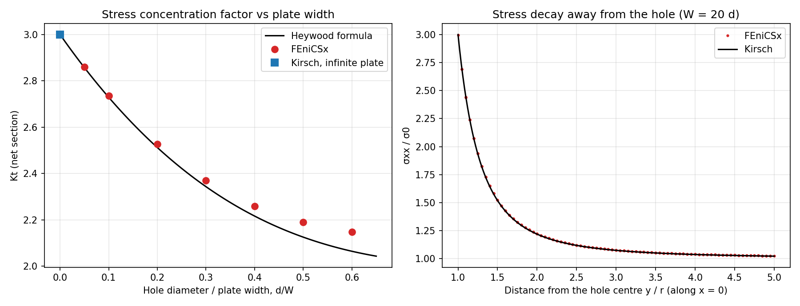
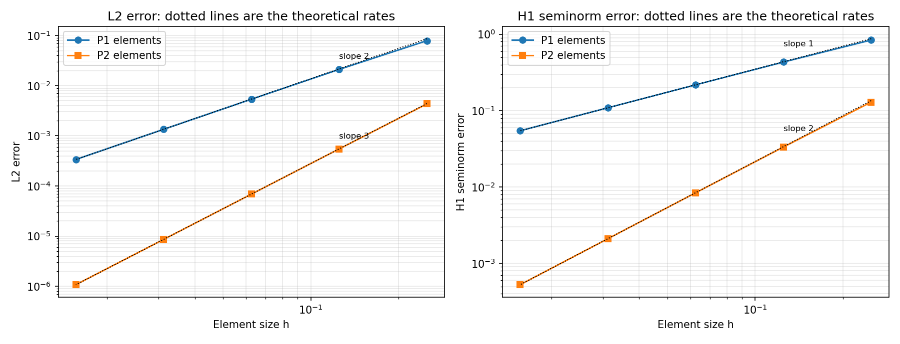
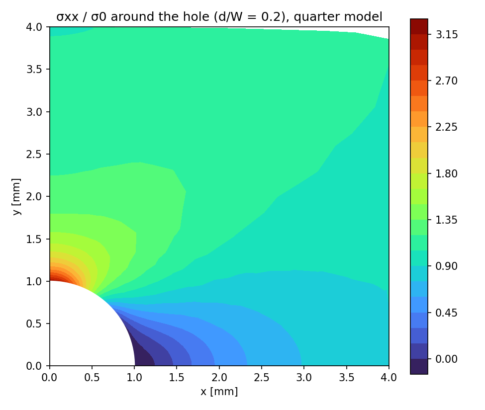

# Finite Elements from First Principles with FEniCSx

Two classic finite element verifications written with [FEniCSx (DOLFINx 0.11)](https://fenicsproject.org/), where the equations are entered in their **weak form** and the library assembles and solves them. No black box: the bilinear forms, boundary conditions and error norms are all written explicitly in Python.

1. **Convergence of the finite element method**: proof that linear and quadratic elements reach their theoretical convergence rates.
2. **Stress concentration at a hole**: plane-stress elasticity verified against Kirsch's analytical solution and Heywood's finite-width formula.



## 1. Convergence rates with a manufactured solution

The Poisson equation −∇²u = f is solved on the unit square with the exact solution u = sin(πx)·sin(πy) (so f = 2π²u and u = 0 on the boundary). The weak form is

∫ ∇u·∇v dΩ = ∫ f v dΩ   for every test function v.

Because the exact solution is known, the error can be measured exactly on each mesh, in the L2 norm (the error in the value) and in the H1 seminorm (the error in the gradient, which is what stresses and fluxes depend on).

| Element | Measured L2 rate | Theory | Measured H1 rate | Theory |
|---|---|---|---|---|
| P1 (linear) | 1.90, 1.97, 1.99, **2.00** | 2 | 0.96, 0.99, 1.00, **1.00** | 1 |
| P2 (quadratic) | 2.98, 3.00, 3.00, **3.00** | 3 | 1.95, 1.99, 2.00, **2.00** | 2 |



The measured rates match finite element theory exactly: the error falls as h^(p+1) in L2 and h^p in H1 for elements of degree p. Two practical consequences:

- **Gradients (stresses, heat fluxes) converge one order slower than the field itself.** Halving the element size halves the stress error with linear elements, but quarters it with quadratic ones.
- **Quadratic elements are far more efficient:** on the finest mesh, P2 reaches an L2 error of 1.1 × 10⁻⁶ with 16,641 unknowns, while P1 is still at 3.4 × 10⁻⁴ with 4,225, about 300 times more error.

This is the same test used to verify research and commercial codes (the method of manufactured solutions).

## 2. Plate with a hole in tension

A plate of width W and length 2W with a central hole of diameter d is pulled with a stress σ₀ = 100 MPa. Only a quarter is modelled, with symmetry conditions (ux = 0 on x = 0, uy = 0 on y = 0). Plane-stress linear elasticity:

∫ σ(u) : ε(v) dΩ = ∫ t·v dΓ,   σ = 2μ ε + λ* tr(ε) I,   λ* = 2λμ/(λ + 2μ)

The mesh is built with Gmsh (refined at the hole) and solved with quadratic (P2) triangles.

### Mesh convergence and the infinite-plate limit (W = 20 d)

| Element size at the hole | Unknowns | Peak stress | Kt (gross) | Kt (net) |
|---|---|---|---|---|
| 0.40 mm | 5,618 | 308.5 MPa | 3.085 | 2.931 |
| 0.20 mm | 13,942 | 304.8 MPa | 3.048 | 2.896 |
| 0.10 mm | 38,362 | 302.0 MPa | 3.020 | 2.869 |
| 0.05 mm | 119,722 | 301.0 MPa | 3.010 | 2.860 |

The peak stress converges smoothly towards **Kt = 3**, Kirsch's exact result for an infinite plate: the stress at the edge of a small hole is three times the applied stress, whatever the hole size. The stress decay away from the hole also follows Kirsch's solution, σxx/σ₀ = ½(2 + r²/y² + 3r⁴/y⁴) (right-hand plot above).

### Finite-width plates vs Heywood's formula

When the hole is large compared with the plate, the remaining section carries more load and the stress field changes. Referred to the net-section stress, Heywood's formula is Kt = 2 + (1 − d/W)³.

| d/W | 0.05 | 0.10 | 0.20 | 0.30 | 0.40 | 0.50 | 0.60 |
|---|---|---|---|---|---|---|---|
| FEniCSx | 2.860 | 2.736 | 2.528 | 2.370 | 2.260 | 2.189 | 2.148 |
| Heywood | 2.857 | 2.729 | 2.512 | 2.343 | 2.216 | 2.125 | 2.064 |
| Difference | +0.1% | +0.3% | +0.6% | +1.2% | +2.0% | +3.0% | +4.1% |

Agreement is within 0.6% up to d/W = 0.2. The growing difference for large holes is expected: Heywood's expression is an empirical fit with an accuracy of a few percent, and the plate here has a finite length (2W), so for wide holes the loaded ends are closer to the hole. The FEA is the more complete model of this specific geometry.



## Implementation notes

- Boundary conditions are applied on the vector sub-spaces (`V.sub(0)`, `V.sub(1)`) for the symmetry planes.
- Stresses are computed by interpolating the UFL stress expression into a discontinuous P1 space, then read at the top of the hole.
- The boundary markers are built from coordinates with `locate_entities_boundary`, so the script does not depend on how a given DOLFINx version imports the Gmsh physical groups. (The first version relied on the Gmsh tags; in DOLFINx 0.11 the loaded edge was not found and the load was never applied, which showed up immediately as a zero stress.)

## How to run

```bash
sudo add-apt-repository ppa:fenics-packages/fenics
sudo apt install fenicsx
python3 fem_verification.py
```

Runs in under a minute. Written for DOLFINx 0.9 to 0.11.

## Possible extensions

- An error estimator and adaptive mesh refinement around the hole
- Elastic-plastic material at the hole edge
- Fatigue notch sensitivity (Kf vs Kt)
